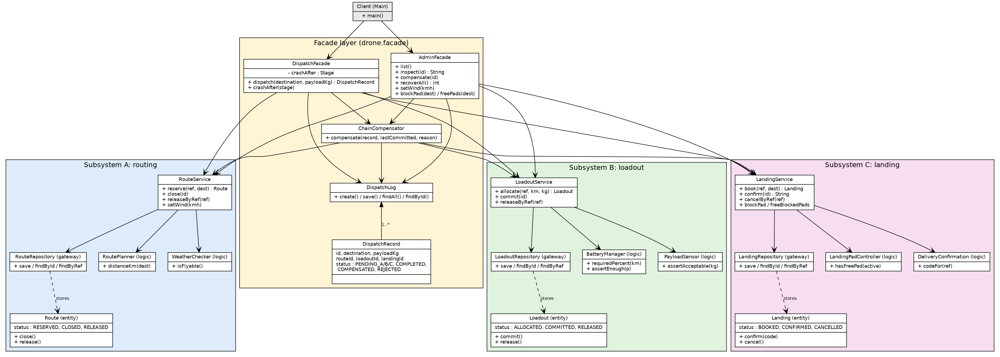

# Delivery Drone Dispatch: Facade over a three-stage chain

**Name:** Aidar Murat
**Group:** SE - 2539
**Assignment 4:** Facade pattern, domain 11 "Delivery Drone Dispatch"

One client call, `dispatch(destination, payloadKg)`, runs three independent subsystems in order:

| Step | Subsystem | Classes | What it does |
|------|-----------|---------|--------------|
| A | `routing` (reserve) | `Route`, `RoutePlanner`, `WeatherChecker`, `RouteRepository`, `RouteService` | checks wind, plans the route, reserves it |
| B | `loadout` (execute) | `Loadout`, `BatteryManager`, `PayloadSensor`, `LoadoutRepository`, `LoadoutService` | checks payload weight and battery, allocates the drone loadout |
| C | `landing` (finalize) | `Landing`, `LandingPadController`, `DeliveryConfirmation`, `LandingRepository`, `LandingService` | books the landing pad, confirms the delivery |

Each subsystem has its own entity with 3 statuses and its own legal transitions, pure business-logic classes, and its own persistence gateway. No subsystem imports another one (`drone.common` only holds a tiny file helper and one exception).

Two facades (`drone.facade`):
- `DispatchFacade`: the client workflow (A, then B, then C, with decisions and compensation).
- `AdminFacade`: list/inspect, manual compensation, restart recovery, "what-if" switches (wind, blocked pad).

## Run (single commands)

```
mvn compile exec:java      # start the console demo (Java 17+)
mvn test                   # unit tests + JaCoCo report: target/site/jacoco/index.html
mvn verify                 # same, and fails if line coverage < 80%
```

**Reset the persisted store to a clean state:** stop the app and delete the `data/` folder (`rm -rf data`). A custom folder can be used: `mvn compile exec:java -Dexec.args="mydata"`.

## Persistence

Plain CSV-like files in `data/`: `routes.csv`, `loadouts.csv`, `landings.csv` (one per subsystem, written by that subsystem's own repository) and `dispatches.csv` (progress of the chain, written by the facade). Every read and write goes to disk; there is no in-memory cache.

Chain status per dispatch: `PENDING_A` (created) -> `PENDING_B` (A done) -> `PENDING_C` (A and B done) -> `COMPLETED`; failures end as `COMPENSATED` (something was undone) or `REJECTED` (step A failed, nothing to undo).

On start-up `AdminFacade.recoverAll()` reads `dispatches.csv`; every dispatch still in `PENDING_*` is rolled back by looking at what each subsystem actually persisted for it (C, then B, then A, each undo is idempotent).

## Failure scenarios (all reachable in the demo)

| Scenario | How to trigger in the demo | Result |
|----------|----------------------------|--------|
| **B fails after A** (compensate A only) | new delivery with payload **8** kg (limit 5 kg), or to `AIRPORT` (battery not enough) | route `RELEASED`, no loadout, no landing, dispatch `COMPENSATED` |
| **C fails after A and B** (compensate B, then A) | menu 5 "Block landing pad" at `CAMPUS`, then deliver to `CAMPUS` | loadout `RELEASED`, route `RELEASED`, dispatch `COMPENSATED` |
| Extra failure at step A (nothing committed) | menu 4, wind `60`, then any delivery; or unknown destination | dispatch `REJECTED`, nothing persisted by A/B/C |
| Invalid input | empty destination, payload <= 0, non-number | `InvalidOrderException`, nothing saved |
| Crash mid-chain | menu 8 arm crash after `B`, then a delivery; the app dies; start again | startup message "rolled back 1 unfinished dispatch" |

Own exceptions: `StepFailedException` (a subsystem step failed), `InvalidOrderException`, `DispatchFailedException`, `SimulatedCrashException`.

Use menu 3 "Inspect" after each scenario: it shows the state stored by all three subsystems.

## Principle of Least Knowledge: before / after

**Before (no facade).** The client knows 9+ classes and the order, the compensation rules and the persistence details of all three subsystems:

```java
Route route = routeService.reserve(ref, dest);                       // friend 1
double km = route.getDistanceKm();                                   // friend of a friend
Loadout l;
try {
    l = loadoutService.allocate(ref, km, kg);                        // friend 2
} catch (StepFailedException e) {
    routeService.releaseByRef(ref);                                  // client does A's undo
    throw e;
}
try {
    Landing p = landingService.book(ref, dest);                      // friend 3
    routeService.close(route.getId());
    loadoutService.commit(l.getId());
    code = landingService.confirm(p.getId());
} catch (StepFailedException e) {
    loadoutService.releaseByRef(ref);                                // client does B's undo
    routeService.releaseByRef(ref);                                  // and A's undo
    throw e;
}
// ... and it must also write the chain status to disk itself
```

**After (with facade).** The client has one immediate friend:

```java
DispatchRecord r = dispatchFacade.dispatch("CAMPUS", 2.0);
System.out.println(r.getCode());
```

The client does not know that routes, loadouts or landings exist, and does not know the order or the undo rules.

## Facade vs. Adapter (reflection)

An Adapter has the intent of *making one existing interface look like another interface the client expects*. It converts, one-to-one. In my project nobody needs that: `RouteService`, `LoadoutService` and `LandingService` already have clean interfaces, and the client does not expect any of them in a different form.

What the client needs is the opposite: not to deal with three subsystems at all. "Deliver this parcel" is one logical operation, but behind it is a sequence (route, loadout, landing) with dependencies between the steps and a rule that decides what to undo when step B or C fails. That coordination, plus the persisted chain status that allows recovery after a restart, is the intent of a Facade: give a simple, higher-level interface to a group of subsystems and hide how they work together. Even if I wrapped each subsystem with an adapter, the client would still need to know the order and the compensation rules; only the facade removes that knowledge.

## UML class diagram

`docs/uml.png` (also `docs/uml.svg`, source `docs/uml.dot`):



## Tests (F.I.R.S.T.)

- 35 JUnit 5 tests; each test gets a fresh `@TempDir` store, so tests are fast, independent and repeatable and assert their results automatically.
- Domain-specific language: `DroneWorld` (test helper), e.g.
  `world.padBlockedAt("CAMPUS"); world.deliveryFails("CAMPUS", 2.0); world.routeOf("D1", RELEASED).loadoutOf("D1", RELEASED).noLandingFor("D1");`
- `RoutingSubsystemTest`, `LoadoutSubsystemTest`, `LandingSubsystemTest`: each subsystem used alone, without the facade.
- `DispatchFacadeTest`: happy path, **B fails (compensate A)**, **C fails (compensate B then A)**, bad weather, unknown destination, invalid input, **persistence-reload tests** (crash after A / after B, restart, recovery from the persisted status).
- `AdminFacadeTest`: inspect, manual compensation, recovery, freeing a pad.
- Coverage: JaCoCo (`pom.xml`), the demo class `drone.app.*` (console I/O only) is excluded; everything else (three subsystems and both facades) must be at least 80% lines (`mvn verify`).
